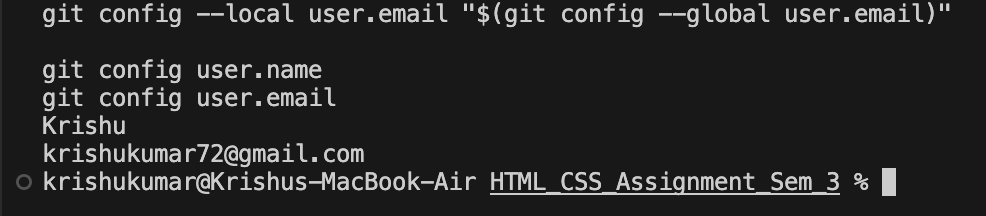
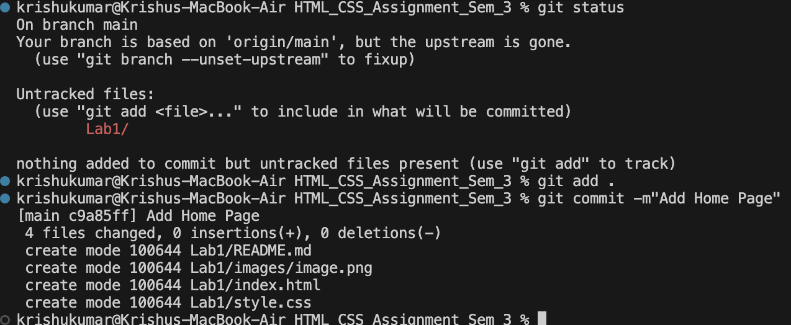
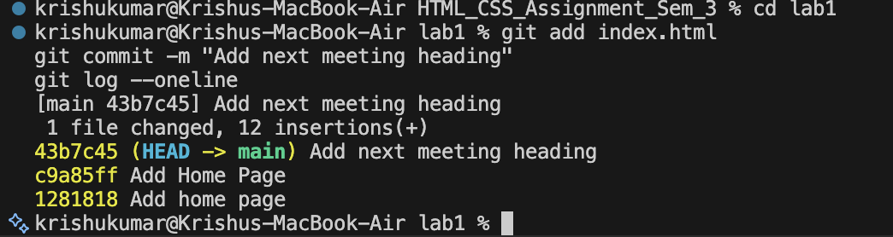

# Lab 1: Starting a Git Repository

## 1. Experiment Title
Starting a Git Repository

## 2. Aim
To create a Git repository, configure user details, create and track an HTML file, save changes using commits, and view the commit history.

## 3. Software / Tools Required
- Operating System: macOS
- Code Editor: Visual Studio Code
- Version Control System: Git
- Programming Language: HTML
- Terminal: VS Code Integrated Terminal

## 4. Theory

**Git** is a distributed version control system used to track changes in files and manage project versions.

A Git repository stores project files and their revision history. Git helps developers maintain different versions of a project and track modifications.

Important Git commands used in this experiment:

- `git init`: Initializes a new Git repository.
- `git config`: Configures Git user details.
- `git status`: Displays the current state of the working directory.
- `git add`: Adds files to the staging area.
- `git commit`: Saves staged changes to the repository.
- `git log --oneline`: Displays commit history in a compact format.

## 5. Algorithm / Procedure

### Task 1: Starting a Git Repository
1. Create a folder named `html-lab`.
2. Open the folder in the terminal.
3. Initialize the repository using `git init`.
4. Configure the local Git username and email.
5. Verify the configured details.

### Task 2: Creating and Committing an HTML File
1. Create a file named `index.html`.
2. Write a basic HTML document containing an h1 heading.
3. Check the repository status using `git status`.
4. Add the file using `git add index.html`.
5. Commit the file using the message `Add home page`.

### Task 3: Updating and Viewing Commit History
1. Open the existing `index.html` file.
2. Add an h2 heading below the h1 heading.
3. Stage the modified file using `git add index.html`.
4. Commit the changes using the message `Add next meeting heading`.
5. Display the commit history using `git log --oneline`.

## 6. Program / Queries / Commands

### Task 1: Git Repository Initialization

```bash
mkdir -p ~/Desktop/html-lab
cd ~/Desktop/html-lab
git init

git config --local user.name "$(git config --global user.name)"
git config --local user.email "$(git config --global user.email)"

git config user.name
git config user.email
```

### Task 2: HTML Program

**File Name:** `index.html`

```html
<!DOCTYPE html>
<html lang="en">
<head>
    <meta charset="UTF-8">
    <title>My First Git Repository</title>
</head>
<body>
    <h1>Welcome to My HTML Lab</h1>
</body>
</html>
```

**Git Commands:**

```bash
git status
git add index.html
git commit -m "Add home page"
```

### Task 3: Updated HTML Program

**File Name:** `index.html`

```html
<!DOCTYPE html>
<html lang="en">
<head>
    <meta charset="UTF-8">
    <title>My First Git Repository</title>
</head>
<body>
    <h1>Welcome to My HTML Lab</h1>
    <h2>Next Lab Meeting</h2>
</body>
</html>
```

**Git Commands:**

```bash
git add index.html
git commit -m "Add next meeting heading"
git log --oneline
```

## 7. Input

- Repository Name: html-lab
- HTML File Name: index.html
- First Heading: Welcome to My HTML Lab
- Second Heading: Next Lab Meeting
- First Commit Message: Add home page
- Second Commit Message: Add next meeting heading

## 8. Output

### Task 1: Git Repository Initialization and Configuration



### Task 2: HTML File Creation and First Commit



### Task 3: Adding Second Heading and Viewing Commit History



## 9. Result

Successfully created and initialized a Git repository, configured local Git user details, created an HTML file, tracked and committed changes, and displayed the commit history using Git commands.

## 10. Viva-Voce Questions

**Q1. What is Git?**

Git is a distributed version control system used to track changes in source code.

**Q2. What is a Git repository?**

A Git repository is a storage location that contains project files and their version history.

**Q3. What is the purpose of the git init command?**

The `git init` command initializes a new Git repository in the current directory.

**Q4. What is the difference between git add and git commit?**

`git add` stages changes, whereas `git commit` saves the staged changes in the repository history.

**Q5. What is the purpose of git log --oneline?**

It displays the commit history in a compact format, showing commit IDs and messages.