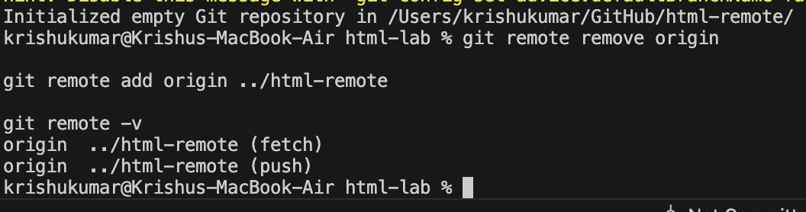
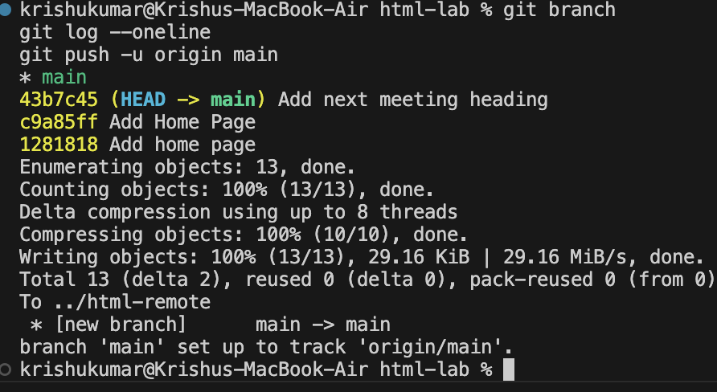
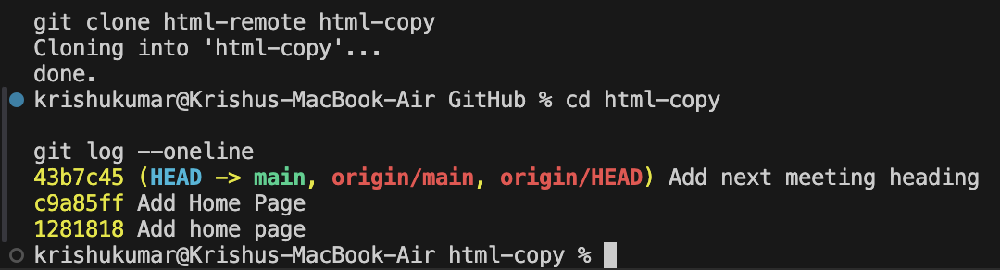

# Lab 2: Pushing and Cloning a Repository

## 1. Experiment Title
Pushing and Cloning a Repository

## 2. Aim
To create a bare Git repository, connect it with a local repository, push commits to the remote repository, and clone the remote repository into a new directory.

## 3. Software / Tools Required
- Operating System: macOS
- Code Editor: Visual Studio Code
- Version Control System: Git
- Terminal: VS Code Integrated Terminal

## 4. Theory

Git is a distributed version control system that allows developers to manage and share project files.

A remote repository is a repository stored at another location that can be accessed by a local repository.

A bare repository stores Git version control information without maintaining a working directory. It is commonly used as a central repository for sharing changes.

The `git push` command uploads local commits to a remote repository, whereas `git clone` creates a local copy of an existing repository.

Important Git commands used in this experiment:

- `git init --bare`: Creates a bare Git repository.
- `git remote add`: Connects a local repository to a remote repository.
- `git remote -v`: Displays configured remote repositories.
- `git push`: Uploads commits to a remote repository.
- `git clone`: Creates a local copy of a repository.
- `git log --oneline`: Displays commit history in a compact format.

## 5. Algorithm / Procedure

### Task 1: Create a Bare Repository and Configure Remote

1. Open the existing local Git repository.
2. Create a bare repository named `html-remote`.
3. Remove the existing remote from the temporary practice repository.
4. Add the bare repository as a new remote named `origin`.
5. Verify the remote configuration using `git remote -v`.

### Task 2: Push Commits to Remote Repository

1. Open the local `html-lab` repository.
2. Check the current branch using `git branch`.
3. View existing commits using `git log --oneline`.
4. Push the commits to the remote repository using `git push -u origin main`.
5. Verify that the push operation is successful.

### Task 3: Clone the Remote Repository

1. Navigate to the GitHub working directory.
2. Clone the remote repository into a new folder named `html-copy`.
3. Open the cloned repository.
4. Display the commit history using `git log --oneline`.
5. Verify that all previous commits are available in the cloned repository.

## 6. Program / Queries / Commands

### Task 1: Create and Configure a Bare Repository

```bash
git init --bare ../html-remote

git remote remove origin

git remote add origin ../html-remote

git remote -v
```

### Task 2: Push Commits to Remote Repository

```bash
git branch

git log --oneline

git push -u origin main
```

### Task 3: Clone the Remote Repository

```bash
cd ~/GitHub

git clone html-remote html-copy

cd html-copy

git log --oneline
```

### Additional Command Used to Configure Bare Repository HEAD

```bash
git --git-dir=../html-remote symbolic-ref HEAD refs/heads/main
```

## 7. Input

- Local Repository: `html-lab`
- Bare Repository: `html-remote`
- Remote Name: `origin`
- Branch Name: `main`
- Cloned Repository: `html-copy`
- Commit History: Three existing commits from Lab 1

## 8. Output

### Task 1: Bare Repository Creation and Remote Configuration



### Task 2: Pushing Commits to Remote Repository



### Task 3: Cloning Repository and Viewing Commit History



## 9. Result

Successfully created a bare Git repository, configured it as a remote repository, pushed local commits to the remote repository, cloned the repository into a new directory, and verified the commit history.

## 10. Viva-Voce Questions

**Q1. What is a remote repository?**

A remote repository is a Git repository stored at another location that allows developers to share and access project changes.

**Q2. What is a bare repository?**

A bare repository stores Git version control data without a working directory.

**Q3. What is the purpose of the git push command?**

The `git push` command uploads local commits to a remote repository.

**Q4. What is the purpose of the git clone command?**

The `git clone` command creates a local copy of an existing Git repository.

**Q5. What is the use of git remote -v?**

It displays the URLs of configured remote repositories for fetching and pushing.

**Q6. What is the meaning of origin in Git?**

Origin is the conventional name assigned to a remote repository.

**Q7. What is the difference between git clone and git pull?**

`git clone` creates a new local copy of a repository, whereas `git pull` fetches and integrates changes into an existing local repository.